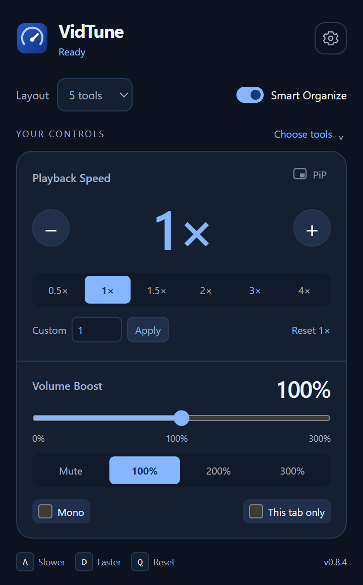
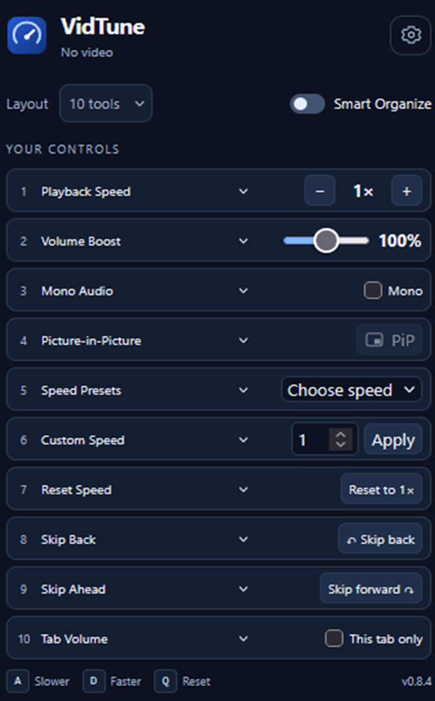
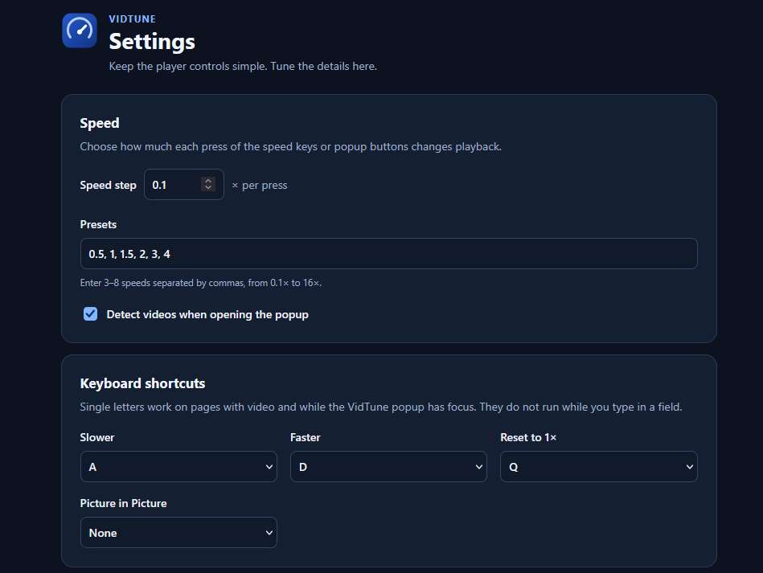
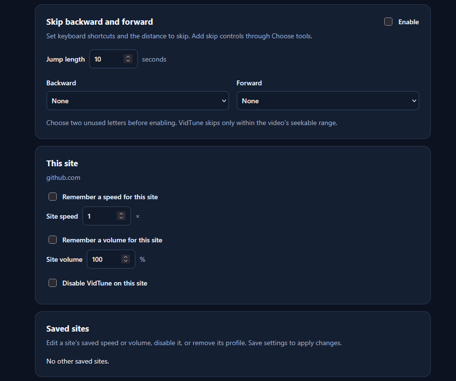

# VidTune

**A lightweight video speed controller and volume booster for Firefox, Chrome, and Edge.**

VidTune adds quick controls for video speed, louder audio, mono sound, and Picture in Picture. Choose a compact layout that fits the way you watch.

[Get VidTune for Firefox](https://addons.mozilla.org/pt-BR/firefox/addon/vidtune/) · [Privacy policy](PRIVACY.md)

## Main controls

- **Video speed:** slow down or speed up from 0.1× to 16×. Use presets, enter a custom speed, or press **A** / **D**. Press **Q** to reset.
- **Volume boost:** adjust from mute to 300%. Keep a separate volume for each tab when you want.
- **Mono audio:** send a blended left-and-right mix to both sides.
- **Picture in Picture:** pop the video into a small floating window when the browser and player allow it.
- **Site preferences:** remember speed and volume for a website.

## Make the popup yours

The default layout has **5 tools** with **Smart Organize** on. Pick 2, 5, or 10 tools, choose what each slot does, and switch Smart Organize on or off at any time.

Smart Organize groups related controls so speed, volume, and video actions are easy to find.

## Preview

<table align="center" cellspacing="0" cellpadding="4">
  <tr>
    <td align="center">
      <a href="presentation/screenshots/default-smart-organize.png"></a><br>
      <sub><b>Everyday controls</b> · 5 tools with Smart Organize</sub>
    </td>
    <td align="center">
      <a href="presentation/screenshots/layout-10-tools.png"></a><br>
      <sub><b>Full control</b> · 10 tools in one compact layout</sub>
    </td>
  </tr>
</table>

<p align="center">
  <a href="presentation/screenshots/settings-speed-shortcuts.png"></a><br>
  <sub><b>Speed and shortcuts</b> · Choose speed steps, presets, and keys</sub>
</p>

<p align="center">
  <a href="presentation/screenshots/settings-site-controls.png"></a><br>
  <sub><b>Site controls</b> · Save speed and volume for each website</sub>
</p>
Feature images for the Firefox listing: [speed controls](presentation/01-playback-speed.png) · [volume boost](presentation/02-volume-boost.png) · [Smart Organize](presentation/03-smart-organize.png)

## Use VidTune

**Firefox:** [install from Firefox Add-ons](https://addons.mozilla.org/pt-BR/firefox/addon/vidtune/).

**Chrome and Edge:** build the Chromium version and load `dist-chromium/` as an unpacked extension.

VidTune works in Firefox, Chrome, and Microsoft Edge. Protected videos, browser-restricted pages, and players that block audio processing can limit some controls.

## Build from source

Requires Node.js 20 or later.

```sh
npm ci
npm run build
```

Run `npm test` and `npm run lint` to check the project. See `package.json` for browser-specific tests and packaging.

## Privacy

Settings stay in your browser. VidTune has no analytics. Read the [privacy policy](PRIVACY.md) for permissions and audio processing details.
